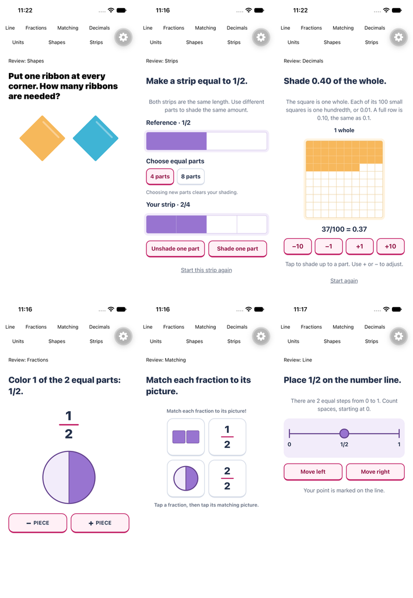

# Math Mews puzzle style guide

Puzzle visuals should make the next mathematical action easy to see. Use clear silhouettes, flat color, rounded controls and generous space, with enough detail to identify an object immediately. Keep the app’s berry actions, rounded Nunito text and warm cat personality.

This guide applies to lesson diagrams, answer models and picture help. Home rooms and furniture keep their authored Blender materials. Use [DESIGN.md](../DESIGN.md) for the broader application and its shared control and room guidance.

## Principles

1. **The math determines the geometry.** Equal pieces have equal areas, bars share a zero baseline, and markers sit at their exact values. Decoration stays inside these boundaries.
2. **Make the silhouette readable first.** A scale needs two equal pans, a beam and a base. An apple needs a recognizable body, stem and leaf. Extra detail cannot rescue an unclear shape.
3. **Give color a consistent job.** Use blue for geometry and general number lines, lavender for fraction models, and bright gold for decimal models. Berry identifies actions; green/red communicate results. Pair color with text, shape or state.
4. **Keep each diagram focused.** Show the givens and the learner’s work. Leave hidden answers hidden until the task permits revealing them. Use a separate example for worked help.
5. **Build a family of reusable components.** Extend the shared model before creating another visual treatment for the same mathematical idea.

## Palette

Import [PuzzleColors and DiagramColors](../constants/puzzle-theme.ts). The values below identify roles; reference the tokens in code rather than duplicating hex values.

| Role | Token | Color |
| --- | --- | --- |
| Canvas and cards | `PuzzleColors.background`, `card` | `#FFFFFF` |
| Main text | `PuzzleColors.text` | `#24314B` |
| Supporting text | `PuzzleColors.textMuted` | `#5E687B` |
| Actions and selected controls | `PuzzleColors.primary` | `#C32468` |
| Action text on light surfaces | `PuzzleColors.primaryDark` | `#931445` |
| Selected control surface | `PuzzleColors.selectedSurface` | `#FFF0F6` |
| Resting control border | `PuzzleColors.cardBorder` | `#D7DDE8` |
| Geometry empty regions and stages | `DiagramColors.geometrySurface` | `#E5F5FB` |
| Geometry grid lines | `DiagramColors.geometryGrid` | `#A3D5E4` |
| Geometry quantities and markers | `DiagramColors.geometryFill` | `#40B4D5` |
| Geometry boundaries and axes | `DiagramColors.geometryEdge` | `#19758F` |
| Fraction fill / pale background | `DiagramColors.fractionFill`, `fractionSurface` | `#9874D0`, `#F2ECFA` |
| Fraction grid / boundary | `DiagramColors.fractionGrid`, `fractionEdge` | `#CDBBE6`, `#65438F` |
| Decimal fill / pale background | `DiagramColors.decimalFill`, `decimalSurface` | `#F7B85C`, `#FFF3DF` |
| Decimal grid / boundary | `DiagramColors.decimalGrid`, `decimalEdge` | `#EACD98`, `#D8933E` |
| Scale beam and clock rim | `DiagramColors.gold` | `#F7B85C` |
| Inset shape highlight | `DiagramColors.highlight` | `#FFFFFF55` |
| Warm highlight and edge | `DiagramColors.goldLight`, `goldEdge` | `#FFCF85`, `#D8933E` |
| Solid top, front and side | `DiagramColors.solidTop`, `solidFront`, `solidSide` | `#D9C5F4`, `#B491DF`, `#9170C6` |
| Success | `PuzzleColors.success`, `successSurface` | `#267324`, `#EEFBDE` |
| Mistake | `PuzzleColors.incorrect`, `incorrectSurface` | `#C82E39`, `#FFF0F0` |

Use dark text on pale surfaces. Keep model labels outside saturated fills. Each family uses a coordinated fill, pale background, grid and dark edge. Reference and learner models share a hue, as do whole, tenth and hundredth blocks. Never recolor individual pieces randomly or give equivalent quantities different colors. Fraction number lines use lavender with the other fraction models; general number lines remain blue. Empty strip and decimal cells stay white. Colored area, boundaries and numeric labels carry the quantity, so distinguishing the family hues is never required to answer. Decimal gold matches the shapes’ gold. It is a material color, not a warning state; numeric labels and cell boundaries also communicate the quantity. Reserve white labels for controls with sufficiently dark fills. Distinct chart series and matched pairs may use the established berry, teal, blue and lavender treatments when their labels carry the same distinction.

## Shape and depth

Use solid fills and clear two- to three-point diagram outlines. Flat polygons use one rounded inset highlight parallel to an upper edge. On a rotated square, it follows the upper-right diagonal; on a rectangle, it follows the horizontal top. Keep the line inside the silhouette and stop before both corners. Match the restrained light color of the progress bar rather than copying its orientation. Avoid large side facets that make a flat shape look folded, glossy gradients, fuzzy shadows and decorative textures. True solids may use separate flat face colors to explain their volume. Screen-header glows and existing primary-button treatments belong to the application shell.

Use rounded corners for controls and non-mathematical containers, typically 12–18 points. Keep polygon vertices identifiable and retain equal partition spacing and the grid’s underlying dimensions. Strips and decimal grids use concentric rounded outer and inner corners: `innerRadius = max(0, outerRadius − inset)`. Use the shared [`insetRadius`](../utils/border-radius.ts) helper; calculate the total inset after scaling and include any border thickness. The shared `DiagramFrameMetrics` uses a 12-point outer radius and 6-point inset, giving a 6-point inner radius. Clip the whole’s outermost corners and round its boundary to that inner radius; keep internal divisions straight. Empty strip and decimal regions are white with light rules from their family palette. This decorative clipping does not alter cell counts or touch coordinates.

Controls use a two-point outline and a four-point bottom edge. This depth means “pressable”; diagrams should not acquire button styling unless they are controls. Avoid putting an already outlined model inside an unnecessary second card.

The same rule applies to spatial grids, difficulty tabs, chart highlights and trail insets. See [app-wide nested corners](../DESIGN.md#nested-corners) for the audited dimensions, store-card treatment and native-border cases.

## Diagram recipes

| Model | Reuse | Keep exact |
| --- | --- | --- |
| Fraction pie | [FractionPieChart](../components/puzzle/FractionPieChart.tsx) | Equal angles, independent slice selection, full-circle boundary; lavender fills and dark purple dividers |
| Fraction cards and strips | [FractionGridChart](../components/puzzle/FractionGridChart.tsx), [FractionStripTask](../components/puzzle/FractionStripTask.tsx) | Equal cells; comparison strips share the same whole width and contiguous partitions |
| Integer and signed number lines | [NumberLineTrack](../components/puzzle/NumberLineTrack.tsx) | Uniform spacing, marker centered on a tick, scroll position and full touch targets |
| Fraction number lines | [FractionNumberLineTask](../components/puzzle/FractionNumberLineTask.tsx) | A pale lavender stage and purple marker; endpoints stay 0 and 1, with equal intervals |
| Balances and equations | [BalanceScale](../components/puzzle/BalanceScale.tsx), [EquationBoardModel](../components/puzzle/EquationBoardModel.tsx) | Equal pans on a level beam; labelled units, explicit zero and the same operation on both sides |
| Ratio tables | [RatioTableModel](../components/puzzle/RatioTableModel.tsx) | Fixed quantity columns, matching scale factors and an answer cell that follows the learner’s input |
| Decimal models | [DecimalGridTask](../components/puzzle/DecimalGridTask.tsx), [DecimalPlaceValueTask](../components/puzzle/DecimalPlaceValueTask.tsx) | Bright gold quantities with a pale cream frame; square whole, exact tenths/hundredths, and 100:10:1 block areas |
| Unit grids and coordinates | [GeometryMeasureTask](../components/puzzle/GeometryMeasureTask.tsx), [BridgeTask](../components/puzzle/BridgeTask.tsx) | Equal units, readable axes, exact point centers and dimensions |
| Bars, clocks, jugs and solids | [EverydayDiagram](../components/puzzle/EverydayDiagram.tsx) | Bar heights, hand angles, liquid amount/capacity ratio, vertices and face relationships |
| Function machines | [FunctionMachineTask](../components/puzzle/FunctionMachineTask.tsx) | Blue input/output surfaces, lavender rule block, unknown operation kept hidden |

For bars, a highlight must stay below the measured top. For jugs, keep the water surface horizontal and the handle outside the scale. For equalities, changing both sides must preserve their meaning; never add a decorative tilt that implies inequality.

## Explain the relationship

A recognizable diagram must also explain the learner's action. Use one primary model with labels attached to its quantities. Remove a second representation when it adds interpretation work without teaching another step.

- Ratio tables use [RatioTableModel](../components/puzzle/RatioTableModel.tsx). Keep Groups and Items in fixed columns. Guided examples put the same multiplication or division arrow between both pairs of values. Easy examples show the contents of one known group and question marks in the requested groups. Do not fill the requested groups with the answer. The answer cell follows the learner's input, including incorrect input, without marking it correct before Check.
- Equation boards use [EquationBoardModel](../components/puzzle/EquationBoardModel.tsx) with the shared balance. An x tile is one unknown; a tile labelled 1 is one unit. Negative units carry an explicit minus sign. Larger constants use a number rather than an unreadable pile. Keep the complete current equation visible alongside the model. After an operation, show the preceding equation and the same operation over both sides, leading to the new equation. Reset removes this step. Operation buttons announce that they affect both sides.
- Never turn an entered answer into a given. Do not show a solved value, completed target diagram or success color merely because the learner has typed a number. Independent ratio practice omits the scaling hint.

These recipes apply the context-specific representations described in [Duolingo's math development article](https://blog.duolingo.com/developing-math/) using the app's existing Nunito, Berry controls and diagram materials. Reference examples inform how a model teaches; the live app and shared components remain the style authority.

## Objects and icons

Use the existing Blender pipeline for recognizable objects such as apples and cookies. Keep a strong silhouette, a small number of useful details, consistent camera framing and transparent backgrounds. Inspect the exported icon at its actual puzzle size, next to the rest of the family. Ribbon bows need two broad folded loops, a small wrapped knot and two visibly notched tails; oval blobs do not communicate tied fabric. See [app icon sources and regeneration](../docs/art/app-icons/README.md).

Build mathematical geometry with native views or Skia so values, divisions and interaction remain exact. Keep flat teaching diagrams visually distinct from the softly rendered objects they count. Do not mix platform emoji, unrelated icon packs or newly generated bitmap diagrams into an established family.

## Text and layout

Use [PuzzleText](../components/puzzle/PuzzleText.tsx), which selects the bundled Nunito family and preserves native text scaling. Match nearby components: questions typically use a 24-point baseline with 32-point line height; reading labels use 16–18 points; prominent values use 22–28 points. These are logical React Native units before scaling, not screenshot pixels.

Keep the question above the model, then place its controls and concise guidance below. Four-card matching tasks use a balanced two-by-two layout; avoid an isolated last card. Use the existing 8, 10, 12, 16 and 20-point spacing patterns. Prefer controls at least 48 points high; preserve the established 44-point navigation targets. Let translated labels wrap rather than shrinking the entire diagram.

Bar charts and clocks reserve room for the question, answer row and picture help. Clock time choices use a compact row when they fit, falling back to full-width choices for larger text so a time never breaks at the colon. Scale the complete clock face, including its numbers and hands, together; keep a roughly 200–240-point dial on standard phone text settings. Derive the plot height from the viewport, with at least one label-height interval between ticks; dense scales and larger system text may expand and scroll. Use a 16-point bold subject label, 14-point bold tabular axis numbers and 17-point heavy group letters. Keep the cat subject icon front-facing. Tighten redundant padding before reducing text or tap targets.

At the iPhone 15’s 393 × 852-point viewport and default system text size, the initial puzzle, every answer/control, picture help and fixed Check action must fit without vertical scrolling. Review the longest prompts and densest models in English, Latvian and Russian. Keep questions at 24/32 points, supporting instructions at 16 points and answer labels at 20 points; sentence-length sharing choices can use 16/22-point text in three cards. Buttons remain at least 48 points high. Short answers use measured columns and return to full width when text needs more room.

Remove repeated instructions before reducing diagram size. Put related controls in a row, and keep the full mathematical givens visible: a budget heading includes budget, item count and required remainder. Dense quantity arrays can use closer, non-overlapping object spacing; rectangles keep equal unit sizes and their true aspect ratio. A model’s outer frame must own its padding—do not draw side gutters outside a full-width view, where the scroll view can clip them. Strip touch coordinates exclude that frame inset.

Also review a 320-point content width and larger system text. Keep scrolling available as an accessibility fallback, with the shared Check action fixed and reachable. Larger labels may wrap or stack; never force a fit by clipping content or disabling font scaling. Labels must stay attached to their values without covering ticks, vertices or contents.

Run the native layout regression with `node scripts/native/check-puzzle-drag.mjs --layout --device <iPhone-15-simulator-UDID>`. It uses disposable progress and checks the longest prompt and densest payload for each layout variant in all three languages. The result bundle includes the measured content and viewport heights. Review interactive states and screenshots as well: a passing height check alone does not prove that labels are legible or diagrams are correct.

## Interaction and motion

Animate a mathematical action: a slice fills, a marker hops one interval at a time, or ten conserved units gather into a rod. Preserve the existing timing and interruption handling of the shared component. Do not add idle wobble, spinning models or celebration inside a measuring diagram.

Respect Reduce Motion and foreground/focus state. Repeated input must continue from visible work without replaying the whole entrance. Selection does not submit an answer. Preserve retry edits, reset behavior, disabled states and alternative buttons for gestures.

Expose accessible names, numeric values and selected/disabled states. Number lines and strips retain increment/decrement actions. Screen-reader descriptions explain the givens without disclosing the answer. Color alone never carries correctness or selection.

## Review before shipping

- [ ] The model is recognizable at actual puzzle size and uses the shared tokens and components.
- [ ] Empty, partial, full, selected, incorrect, correct and disabled states remain clear where applicable.
- [ ] Quantities, intervals, areas and touch coordinates still agree.
- [ ] No hidden answer appears in labels, artwork, accessibility text or automatic animation.
- [ ] Narrow layouts, long translations and larger text keep the task usable.
- [ ] Native taps, scrolling, keyboard or adjustment alternatives, interruption and Reduce Motion still work.
- [ ] Relevant existing model/interaction checks, typecheck and lint pass; rendered screenshots are inspected.
- [ ] Shared changes are reflected here and in DESIGN.md, with current QA images rather than concept mockups.

## Examples and references

The examples use production components. Current color captures and contrast checks live in [the palette review folder](../docs/qa/diagram-palette/2026-11-08/). The [earlier native review](../docs/qa/friendly-puzzle-models/2026-11-08/) and [frame refinement](../docs/qa/friendly-model-refinement/2026-11-08/) document geometry and interaction work; their all-blue fraction and decimal colors are superseded by this palette.

Reference reading: Duolingo’s [shape language](https://blog.duolingo.com/shape-language-duolingos-art-style/) and [math development](https://blog.duolingo.com/developing-math/). Apply clarity, limited detail and reusable visual models through Math Mews’ own colors, typography and original artwork.

Phone layout review: [full iPhone 15 chart screen](qa/chart-phone-layout/2026-11-08/iPhone15-chart.png), [translations and large text](qa/chart-phone-layout/2026-11-08/preview.png). The default English screen is verified to fit without scrolling; accessibility text keeps the scroll fallback.

[Clock and ribbon examples](qa/clock-ribbon/2026-11-08/preview.png) show the compact time-answer row and the revised Blender bow at caption size.

[Ratio and equation teaching examples](qa/bridge-teaching/2026-11-08/results.json) include [an unsolved ratio](qa/bridge-teaching/2026-11-08/en-easy-ratio-start.png), [equal operations](qa/bridge-teaching/2026-11-08/en-easy-equation.png) and [division in Latvian](qa/bridge-teaching/2026-11-08/lv-medium-equation.png). These are native component fixtures with development controls.
