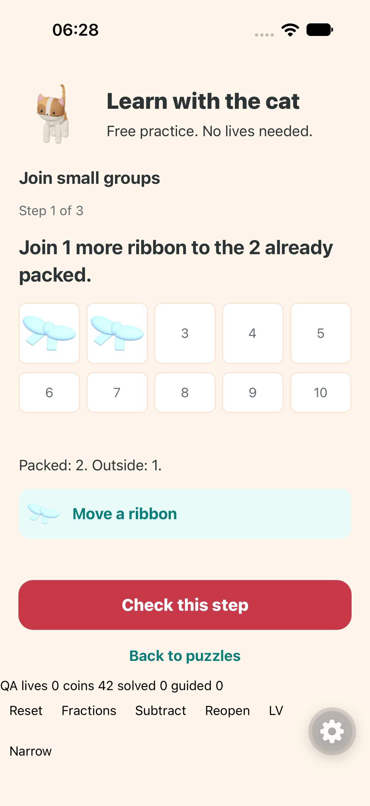
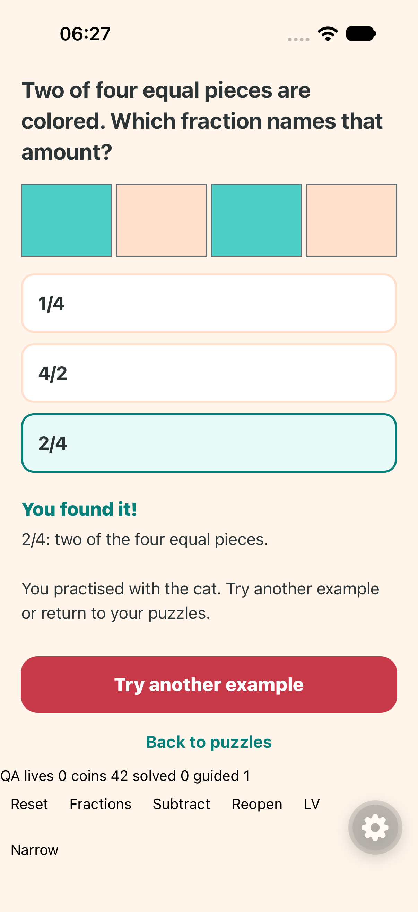
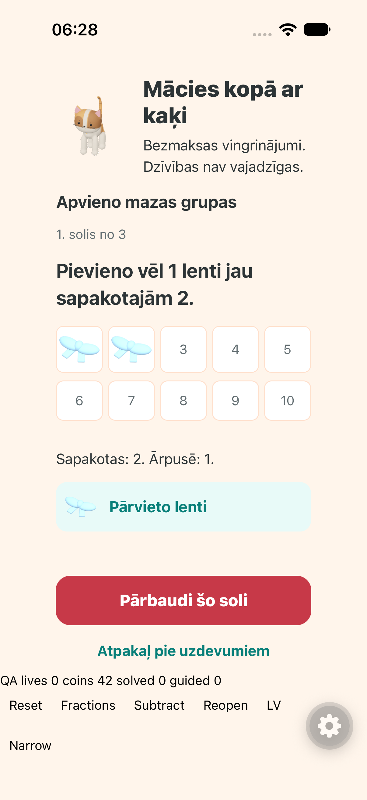
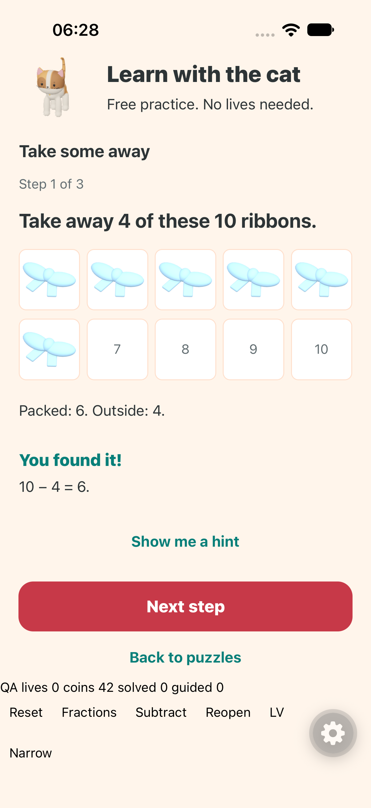

# Guided learning and puzzle progression QA

24 October 2026. Local implementation; no production deployment or player-save changes during native QA.

## Implemented

| Research finding | Change |
| --- | --- |
| Learning stops at zero lives | Learn with the cat stays reachable from the puzzle browser and an unanswered play screen, with free supported tasks and repeatable examples. |
| Answer patterns reward guessing | Comparison sides balance and shuffle; numeric answers vary magnitude rank; review answers vary rank and position independently. |
| Beginner concepts and controls change too quickly | Twenty Easy addition/fraction lessons have explicit skill sequences. Their introductory controls can repeat deliberately. Equivalence follows the first five fraction lessons. |
| Completion does not distinguish assistance | Save independent first successes, helped/retried successes, mistakes and guided sessions separately from earned completion. |
| No clear support or revisit path | Offer support after repeated mistakes, an available next lesson after independent examples, and topic review after two days. |
| Repeated Hard pattern parameters | Pattern-repair multipliers vary across the expanded sequence. |
| Introductory hint does not match small sums | Count-on hints use the actual operands; making ten appears where appropriate. |

Guided tasks are topic foundations. The advanced catalog has not received a complete pedagogical rewrite. The two-success rule suggests a next activity; it does not certify mastery. Skip-ahead placement and untimed copies of scored challenges remain separate proposals, consistent with the research's staged pilot. Educator review, fluent Latvian review and child observations remain external evaluation work.

## Automated checks

- TypeScript and ESLint passed.
- Curriculum checks passed for 2,880 localized puzzles, all 180 lessons, reward IDs, checkpoints, route guards, lives, timed challenges, learning metadata, bilingual guided variants and review choices.
- Numeric practice answer ranks are 90 smallest, 88 middle, 97 largest. Tests also reject biased review rank or displayed-position distributions.
- Model tests cover zero-life guided completion, no wallet/completion/pet changes, repeated callbacks, save/reopen, helped versus independent evidence, retry history, delayed suggestions, daily review limits, wrong-answer life loss, stale-day rejection and expired-challenge settlement.
- Puzzle experience checks cover the depleted play screen's Learn link and source-help recording, plus ordinary drafts, matching, feedback, rewards and life gates.
- Drag and illustrated-object checks passed separately.

The broader suites have two unrelated failures. `npm run test:puzzles` stops in `check-boss-assets.mjs` because the recorded lesson-scene cat hash differs from the current shipped cat. This work does not change either model asset or its recorded hash. `npm run test:game` reaches `check-pet-stat-animation.mjs:189`, whose replay test expects old puzzle-path navigation. The current and HEAD versions of `handleGoHome` both call `router.dismissTo('/')`; this change does not alter that callback. These failures have not been hidden or their assertions weakened.

## Native review

The isolated fixture uses the production GuidedLearning component and an in-memory zero-life save. It tests joining, fraction mistakes and corrections, completion without rewards, reopening, subtraction and a 320-point Latvian layout. It never writes the player's save or wallet.

An independent finish reviewer cleared the implementation after inspecting source and updated screenshots. The original findings were numeric-middle review shortcuts, clipped completion feedback, misleading subtraction status and grammar. Each is fixed. Feedback now scrolls into view after content layout, and Next returns to the new prompt.

Initial static-text assertions failed despite fully visible screenshots. XCTest diagnostics showed multiple accessibility nodes with the same label. The native test now selects the first matching text node and checks its existence and bounds inside the scroll viewport. The final native run passed all four tests with zero failures, plus the separate Home-readiness check. The runner now waits for Home before opening the QA route, avoiding the cold-start link reset. See [the saved XCTest summary](native-results.json). This does not establish VoiceOver behavior; Android, large accessibility text and screen-reader announcements remain unverified.

