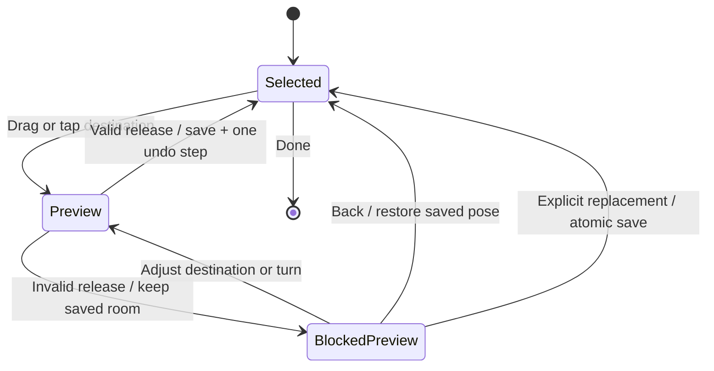

# Furniture placement on mobile

Research and proposed interaction specification for BrainPet / Math Mews. 24 October 2026.

## Recommendation

Keep direct dragging as the fastest way to decorate. Show whether an item fits while it is moving, preserve the room when it does not fit, and let the player correct a blocked placement without starting the whole move again. Make deliberate replacement a separate, clearly labelled action. Keep owned furniture within reach of the room.

The audience is broad, including adults, as confirmed by the product owner. Basic controls should work without a tutorial, while optional precision tools should support careful arrangement. Keep the existing cozy visual style, native 3D room, and English and Latvian support.

The first release should improve feedback, recovery, selection and purchase handoff. It should not introduce a physics simulation that pushes furniture around, or a general building editor with many permanent controls.

## Scope and strength of evidence

This study combines primary documentation for nine games, mobile interaction guidance, a touch research paper, inspection of the current placement code, and the purchase recordings already made in this simulator. The competing games were researched through their documentation; they were not installed and tested during this study. Documented functionality is evidence that a pattern exists, not proof that it will work best for our players.

The earlier [room decoration review](/Users/aigarspeda/Desktop/BrainPet/docs/room-decoration-ux.md) covered basic controls and already informed the current editor. This study extends it with occupied-space rules, recovery states, surface attachments, purchase staging and a validation plan. The broader audience supersedes that review's child-first framing for this proposal.

The checkout is under active development. Code observations below describe the files inspected on 24 October, not a released version. New placement scheduling changes are present in the checkout after the earlier simulator measurements. Those measurements must not be presented as measurements of every subsequent change.

## What the games actually document

| Game and evidence | Verified behavior | Application to BrainPet | Limit of the evidence |
| --- | --- | --- | --- |
| Animal Crossing: Happy Home Designer, official Nintendo 3DS manual, sections 10 and 11 | Stylus drag moves furniture; touch rotates. Small objects can be placed on supporting furniture. A selected group moves together, with exclusions for rugs and wall furniture. | Direct manipulation, explicit support surfaces and eventual group moves are useful precedents. | A stylus and two screens differ substantially from a finger on one phone. The manual does not establish the exact blocked-drop recovery behavior. [Manual](https://www.nintendo.com/eu/media/downloads/games_8/emanuals/nintendo_3ds_2/animal_crossing__happy_home_designer/ElectronicManual_Nintendo3DS_AnimalCrossingHappyHomeDesigner_EN.pdf). |
| The Sims Mobile, historical multilevel FAQ | Yellow identifies overlapping objects that can be stored; red identifies objects that cannot. Idle Sims can be moved aside when placing over them, with an exception for active actions. | Distinguish a solvable furniture conflict from a hard restriction. A moving pet should not behave like an immovable wardrobe. | Historical precedent. EA states that the game ceased to be playable on 20 January 2026. The FAQ does not specify the complete confirmation or undo sequence. [Placement FAQ](https://www.ea.com/ea-studios/motive/news/multilevel-build-feature-faq), [closure FAQ](https://www.ea.com/games/the-sims/news/the-sims-mobile-final-update-faq). |
| The Sims FreePlay, August 2026 store refresh trial | Owned inventory is a filter within the catalog. Variants share cards. Players can manipulate the camera while browsing and tap an existing lot item to move it. | Bring owned furniture into the decorating flow and reduce trips between screens. | The article explicitly describes a limited trial for a small group during one update. It is not evidence of universal availability or measured usability improvement. [EA FAQ](https://www.ea.com/games/the-sims/the-sims-freeplay/news/build-mode-and-home-store-refresh-faq). |
| Toca Boca World, Home Designer menu documentation | An in-house decoration button opens owned furniture, organized into categories and subcategories. The article describes enlarged subcategories and room/activity groupings. | Use pictures and recognizable categories; keep the room as the context for choosing furniture. | This source supports catalog design. It does not establish collision, pushing or invalid-drop behavior. Its version 1.77 description is not a claim about the latest game version. [Toca support](https://tocaboca.helpshift.com/hc/en/3-toca-boca-world/faq/138-what-s-new-in-the-home-designer-decoration-menu/). |
| Unpacking, developer site and mobile launch announcement | The developer lists alternatives to dragging and held-button actions, zoom, larger UI controls, configurable invalid-outline color, reduced animation and an option that removes puzzle placement restrictions. A mobile version launched in August 2023. | Support tap-based placement and visible alternatives. Allow people to decorate at their own pace. | The accessibility list spans platforms. "Allow items anywhere" removes puzzle restrictions; it does not establish arbitrary physical interpenetration. [Game/accessibility page](https://www.unpackinggame.com/), [mobile launch](https://witchbeam.com.au/2023/08/25/unpacking-is-out-now-for-mobile-and-tablets/). |
| Disney Dreamlight Valley, June and December 2024 updates | Consecutive placement and duplication use additional owned copies. The later update adds 16-point rotation. | Avoid repeatedly reopening the catalog for repeated items. Offer extra angles without crowding the basic controls. | These notes do not establish that all collisions are ignored or that furniture automatically moves aside. [June notes](https://disneydreamlightvalley.com/news/update-june-26-2024), [December update](https://disneydreamlightvalley.com/news/SewDelightfulUpdate). |
| Palia, March 2025 update 0.190 | Specific bridge and mine-track pieces snap together. | Apply semantic joins to suitable families, such as kitchen units, rather than treating every nearby edge identically. | The cited primary source supports these specific pieces, not universal snapping or unrestricted overlap. [Patch notes](https://www.palia.com/news/patch-190). |
| Animal Crossing: Pocket Camp Complete, December 2025 support article | Auto-Designer reapplies matching furniture when returning to camp or restarting, including furniture put into storage. Players can remove the active layout design. | Automatic arrangement needs a clear scope and an obvious off switch. It must not unexpectedly override manual work. | This is evidence about automatic layouts, not manual placement collisions. [Nintendo support](https://faq.complete.ac-pocketcamp.com/hc/en-us/articles/40440016662169-My-Layout-Designs-won-t-save-and-furniture-items-keep-being-placed-automatically). |
| The Sims 4, EA control reference | Separate commands exist for undo/redo, off-grid placement, off-angle rotation, slot selection and grid visibility. | Keep precision optional and make the common actions visible on touchscreens. | Keyboard shortcuts do not transfer directly to a phone. The source does not prove a particular collision override policy. [EA controls](https://www.ea.com/games/the-sims/tips-and-tricks?isLocalized=true). |

Several lessons recur, but there is no single documented industry-standard collision policy. Supporting surfaces, intentional replacement, inventory access and precision tools solve different problems. Combining them without clear rules would make the editor harder to predict.

The most useful distinction is between the item the player is experimenting with and the room that has actually been saved. A temporary preview can pass over other objects. A saved arrangement needs consistent geometry and usable pet interactions. This is our design recommendation, not a claim that all the games above implement the same state model.

## What BrainPet already does

The current implementation has substantial foundations worth keeping.

| Area | Code observation | Implication |
| --- | --- | --- |
| Moving | `move()` follows the pointer and can resolve authored support surfaces. It deliberately does not enforce solid collisions during travel. | Players can carry an item across a crowded room without tracing a route around furniture. |
| Dropping | `drop()` resolves nearby snaps, checks boundaries and blockers, and returns the saved pose after an invalid drop. | Existing furniture is protected, but users discover the detailed obstruction after release. |
| Feedback | The selected-item panel names blockers and boundaries. The attempted position and blocking geometry can be visualized. | Extend the existing feedback rather than adding another competing error system. |
| Geometry | Placement uses authored boxes and some footprints; an index narrows candidates for `canPlace()`. The diagnostic feedback path scans obstacles. | The geometric model is more precise than a simple sprite rectangle. Live diagnostics still need a measured cost budget. |
| Snapping | There are small screen-distance wall/object snaps, plus specialized kitchen joins. Floor grid snapping is optional. | Retain these helpers, but make the resulting pose visible before committing it. |
| Surfaces | Small eligible objects can rest on authored surfaces; runtime objects have a `supportId`. | Surface placement exists. Durable parent-child behavior needs a separate design. |
| Saving | Accepted movement updates one item's offset. The finish button clears selection, while its visible label is "Place here". | The button sounds like the commit even though a valid drop already commits. |
| Undo | Layout history keeps up to 20 entries and clears when ownership changes or the room changes. | Preserve ownership safety; group edits need one atomic entry. There is no redo in this hook. |
| New items | Newly observed instance IDs enter an asynchronous nearest-free search. The current code yields after roughly 4 ms of search work. No-space handling keeps the item in inventory and shows an alert. Existing layouts are not automatically repaired on entry. | This is useful protection, but a purchase should not depend on completing a search before visible acknowledgement. A search failure is not proof that no orientation or precise placement could fit. |
| Pet access | The placement resolver does not call the cat navigation or interaction-access system. | A geometrically legal position is not a guarantee that the cat can use the bed or reach a toy. |

Inspected sources: [placement resolver](/Users/aigarspeda/Desktop/BrainPet/utils/room-item-placement.ts), [room integration](/Users/aigarspeda/Desktop/BrainPet/components/pet/PetStage.tsx), [move controls](/Users/aigarspeda/Desktop/BrainPet/components/pet/RoomItemMoveControls.tsx), [world and support surfaces](/Users/aigarspeda/Desktop/BrainPet/utils/native-room-world.ts), [offset updates](/Users/aigarspeda/Desktop/BrainPet/utils/room-placement.ts:295), [home callbacks](/Users/aigarspeda/Desktop/BrainPet/app/index.tsx:648), [history](/Users/aigarspeda/Desktop/BrainPet/hooks/use-room-editor.ts).

The inspected offset callbacks update the selected instance only. They do not establish a persistent attachment tree that moves a tabletop arrangement with its table. Treat that as an implementation gap to validate, not a simulator-confirmed reproduction of every possible support failure.

### Purchase timing evidence

The recorded simulator samples showed approximately 2.2 seconds for a Green Bed bought from its shop card and approximately 2.5 seconds for a Blue Shelf bought through the preview. These were single samples in an Expo development build. The majority of the visible delay occurred before the room transition, including a pause after the balance had already changed. Removing the wallet confirmation wait did not remove the full delay. [Method, timestamps and recordings](/Users/aigarspeda/Desktop/BrainPet/docs/qa/store-purchase-latency/2026-10-24/README.md).

The room was crowded and the shelf visually obscured part of the bed. That observation motivates better selection and access feedback. It does not, on its own, prove illegal geometric overlap. Simulator timing also cannot establish physical-device release performance or identify the responsible CPU work.

## A clear rule for every kind of occupied space

"Something is already there" needs more than one answer.

| Situation | Proposed result | What the player sees |
| --- | --- | --- |
| Two solid pieces physically intersect | Refuse the final placement. Preserve both saved objects. | Outline the blocked portion and name the obstacle, such as "Chair is in the way". |
| Two solids almost touch at compatible edges | Offer a small local snap to a valid pose. | Show the exact snapped preview and a short alignment guide before release. |
| A rug lies under furniture | Allow overlap according to the rug's intended behavior. | Furniture stays on the correct floor/rug height; the rug remains selectable through the item list. |
| A small object's base fits a supported tabletop or shelf | Place it on that surface if its body clears surrounding geometry. | Highlight the supporting surface and show "On shelf" when the target is ambiguous. |
| The object is too large for the shelf | Reject that support candidate. Do not unexpectedly select a floor position under the same finger. | "Doesn't fit on this shelf" and a visible alternative floor target if available. |
| Wall decoration is above floor furniture | Allow it when the actual solid volumes do not intersect. | Show the wall mounting plane and vertical bounds. |
| Curtain and matching window overlap | Use the authored compatibility rule. | A window attachment preview, without a generic red collision warning for the intended overlap. |
| One movable decoration blocks a wanted replacement | Keep the default placement invalid; offer an explicit replacement action. | "Put chair away and place" with both affected objects highlighted. |
| Several objects block the replacement | Do not cascade removals on an ordinary drop. | "3 items in the way". A later review action can list what would go into storage. |
| Cat stands in a valid destination | Treat the cat as a temporary occupant. Arrange a safe departure or landing transition. | Cat moves aside visibly. No furniture jump or lost purchase. |
| Furniture prevents a useful cat interaction | Distinguish a usability warning from a solid collision. | An approach marker and "Cat can't reach this bed". |
| Placement makes essential room access impossible | Reject after a reliable connectivity check. | Highlight the affected route and identify what needs space. |
| New item has no suggested valid location | Keep it owned and unplaced. Let the user rearrange, try a different orientation or put it away. | The selected item stays in the staging card with "Choose a spot" and "Put away". |
| Existing saved room contains an old invalid overlap | Preserve it on load and allow the player to move an item out. | Explain a restriction only when the player edits the affected area. |

For soft decor, author permissive overlap intentionally. A universal bounding box often penalizes leaves, curved arms or empty chair space. Conversely, a universal "ignore collisions" setting can break cat interactions and make arrangements visually confusing. Start with accurate solid parts, named surfaces and explicit exceptions.

Cat reachability needs a staged policy. Initially show warnings for optional interactions. Enforce a hard rule only for verified essential routes and only when the solver can explain the failure. A false "can't reach" result would be especially frustrating in a decorating game. Do not apply a generic rectangular clearance zone to every object if the cat can crawl, jump or approach from another side.

## Proposed mobile interaction

### Enter and select

The Decorate button enters a clear editing state. Tapping furniture selects it; dragging it begins movement without a mandatory long press. Outside decorating, retain the normal cat and furniture interactions.

Selection should follow visible geometry, with a modest touch tolerance. In a dense arrangement, a larger invisible hit target can select the wrong object. If several candidates are close, show a small picture chooser after an ambiguous tap. Keep the existing placed-item list as a dependable way to choose a rug under a bed or a lamp behind a shelf.

The bottom dock shows the selected picture and name, Turn, Put away and More. Keep Size and precise movement available without permanently filling the screen. Use "Done" to end selection after committed edits. Reserve "Place" for an actual uncommitted preview. Keep Undo visible at room level.

### Move and place

During a drag, preserve the point where the player grabbed the object. Render the preview continuously. A small footprint/contact marker should show where it will land even when the finger covers the model. Avoid lifting every object far away from the finger; that can create a new mismatch between touch and destination.

Run a cheap placement-status check while moving and an exact validation when dropping. A valid candidate gets a quiet footprint with a check symbol. A blocked candidate gets a patterned outline and an obstruction symbol. Use text in the dock, outside the finger's path. Color alone must not carry the meaning.

A valid release commits immediately and creates one undo step. The selected state remains so the user can turn or adjust it again. Do not require another confirmation for every ordinary drag.

For an invalid release, the proposed next interaction is a persistent temporary preview at the attempted location. Keep a faint marker at the original saved location. Label the preview "Not placed" and keep Place unavailable. The player can drag again, tap a new destination or choose Back to return to the original. Selecting another item or leaving decorating discards this uncommitted move and restores the saved pose. The preview must never become an invisible blocker or be serialized as furniture.

This recovery behavior needs a prototype comparison against the existing return-to-origin behavior. It should reduce repeated travel, but could confuse someone who mistakes the ghost for a saved placement. If that confusion remains after clear feedback, keep return-to-origin and add a local correction handle at the rejected spot. Do not ship the more complicated state merely because it is possible.

The diagram describes moving an existing item. A newly owned item starts without a saved room pose; canceling its placement returns it to owned inventory. A suggested location is a preview, not a saved placement.

### Snapping that can be predicted

Keep free positioning with gentle assistance as the default. The existing grid can remain an optional precision aid.

Prioritize a deliberately targeted support surface, a compatible family join, then a nearby wall or furniture edge. Show which target is active. Use an entry distance and a slightly larger release distance so small finger movements do not alternate between competing targets. Define those distances in screen units and test them at every zoom level.

Use the same candidate in the preview and final validator. A hidden snap that only happens after release makes a correct gesture feel inaccurate. If the layout changes before commit, revalidate and visibly retain the draft; do not silently substitute a distant result.

Do not search the whole room to repair an existing object's blocked drop. Whole-room search is appropriate for suggesting a starting spot for a new item, and even then the suggestion needs to be visible and editable. Never switch to the other side of an obstacle because it happens to be the nearest valid mathematical solution.

### Tap-based movement and camera control

Provide a "Move" action that allows tap-to-destination placement and the existing directional nudges. This makes exact moves possible without sustained dragging. In this explicit move state, tapping the floor previews a destination; Place commits it. Cancel returns to the saved position. Keep the mode label visible so a floor tap has a predictable meaning.

Use one finger on an object to move it and one finger on empty room space to pan. A two-finger gesture controls the camera. Once a gesture owns the object or camera, it must not switch roles mid-gesture. If a second finger arrives during an object drag, freeze the candidate before entering camera control and require a new deliberate object gesture to resume.

Freeze room viewport dimensions while the dock opens or changes tools. Changing the camera scale or projected coordinate system during a drag can make furniture jump. Do not add edge auto-pan in the first release; the bounded room already has zoom and pan. Add it only if device testing shows that users cannot reach valid destinations.

Apple documents familiar tap/select, drag/move and pinch/zoom mappings. Its touch-target guidance specifies at least 44 by 44 points; Android recommends at least 48 by 48 dp. These are platform units, not raw pixels. Keep BrainPet's main controls around 48 to 60 logical units and test with larger text. [Apple gestures](https://developer.apple.com/design/human-interface-guidelines/gestures), [Apple targets](https://developer.apple.com/design/tips/), [Android accessibility](https://developer.android.com/guide/topics/ui/accessibility/apps).

The Shift research identifies both finger occlusion and ambiguity about the selection point as causes of touch errors. It supports testing a small-target callout, not assuming that a magnifier is always necessary. The study concerns pointing tasks rather than 3D furniture placement, so any benefit here must be measured. [Vogel and Baudisch, CHI 2007](https://www.patrickbaudisch.com/publications/2007-Vogel-CHI07-Shift.pdf).

Tap and nudge alternatives also follow the accessibility principle that dragging should not be the only way to complete an action. WCAG's dragging criterion is a web standard; here it is an interaction design reference rather than a claim of native-app compliance. [W3C explanation](https://www.w3.org/WAI/WCAG22/Understanding/dragging-movements.html).

## Replacement, supported objects and undo

Ordinary movement should never shove neighboring furniture. Pushing creates chains of unintended changes and makes a tightly arranged room costly to edit. Automatic swapping is also ambiguous when two pieces have different sizes, rotations or supported objects.

For the first replacement feature, support one eligible blocker. Show "Put chair away and place" only when removing that chair would make the target legal. Preserve ownership. Apply the removal and new pose as one command, and undo both together. If the chair supports another item, either include that dependency in a clearly explained operation or do not offer the shortcut yet. Never drop its contents invisibly.

For surfaces, make the relationship explicit in saved data: parent instance, local position and local rotation. Moving or rotating a table should move its supported objects with it. Validate the whole set against the room before committing. Removing the support should offer "Put away table and 2 items" with an atomic undo. Detaching one object is an explicit action or a deliberate drag onto another surface.

Rugs should not automatically acquire every object that overlaps them as children. Curtains attached to a window are a different relationship from a vase resting on a table. Define these relationships by object capability; avoid inferring parenthood from any overlapping bounding boxes.

Resize needs separate treatment. Scaling a table should not silently scale all the things on it. Preview the table at the requested size, keep child sizes, and require every child to fit. If one cannot, explain which item prevents the change. Arbitrary furniture groups can come later once support groups work correctly.

An edit command records all affected instance IDs and before/after poses. Drag frames never enter history. Undo must recheck current ownership so a server-rejected purchase cannot be resurrected. Do not undo a purchase charge when the user means to undo a move. Existing history already clears on ownership changes; preserve that protection until any more selective invalidation is proven safe.

## Buying and placing should be one continuous task

The useful endpoint is "I can see and move my item", not merely "the wallet request returned".

1. Acknowledge Buy immediately and prevent an accidental duplicate submission for that interaction.
2. Complete the existing durable local purchase step, then hand its instance ID to the room as an unplaced draft. Keep server reconciliation independent.
3. Show the item selected, with a suggested ghost in the room if a candidate is ready. If assets or search are still running, keep its picture and placement state visible in the dock.
4. Let the player choose the location. If suggestions fail, provide manual placement and Put away without losing the purchase.
5. Save the placement only on a valid drop or explicit Place. Canceling placement stores the item; it does not charge again or imply a refund.

For bed replacement, preserve the old equipped bed until the new bed's placement commits. Buying a new bed and choosing where it belongs are separate state transitions. If the design deliberately keeps only one equipped bed, present that replacement visibly and preserve the old bed in inventory.

Introduce an owned-item drawer inside decorating, with pictures, names and available counts. "Choose item" currently helps find placed objects; it should not be the only nearby catalog while stored items require a trip through the shop. Keep "In room" and "Stored" understandable, and preserve the current category and scroll position after placing one item.

A later "Place another" action can use the remaining owned count. It must not silently purchase another copy. Large catalogs can gain search and grouped variants after the owned drawer solves the basic retrieval problem.

## Performance work and proposed targets

The following numbers are proposed product budgets, not measured competitor performance or guarantees from the simulator samples.

| Event | Initial target on the lowest supported physical device | Measurement |
| --- | --- | --- |
| Buy acknowledgement | Within 100 ms at p95 | Input event to visible pressed/pending response |
| Warm purchase to movable preview | Within 500 ms at p95 | Input event to first rendered preview that accepts movement |
| Drag visual response | Within 50 ms at p95, with stable 60 Hz rendering where supported | Input-to-present latency plus frame timing |
| Collision/status update | Within 100 ms at p95 | Candidate change to updated visible status |
| Release to committed visual pose | Within 100 ms at p95 | Release event to rendered accepted pose |
| Continuous work | Keep placement work comfortably within the 16.7 ms frame budget at 60 Hz | CPU samples and dropped frames, including geometry and rendering |

Cold assets need a separately reported budget. Never classify a thumbnail alone as success for "movable preview". Track durable local save completion and server confirmation independently from these visible milestones.

Instrument buy tap, local purchase queued, local persistence complete, navigation requested, room mounted, placement search start/end, model ready, preview first rendered and first accepted input. Use one correlation ID and a monotonic clock. Run a profiler before attributing the delay to storage, navigation or geometry.

Cache fixed placement geometry and use the existing spatial index for live checks. Measure diagnostic blocker collection as well as boolean validity. Coalesce preview calculations to the current frame, discard obsolete results, and keep an exact final check. Cat connectivity can run after a short stationary period or on release; it should not block every pointer sample.

Do not persist every drag frame or rebuild unrelated room objects for a preview. Cancel outdated suggestion searches after a layout change and validate against the latest layout version before committing. Multiple rapid purchases must reserve distinct instances and cannot all consume the same suggested free spot.

The repository contains a [desktop JavaScript microbenchmark](/Users/aigarspeda/Desktop/BrainPet/scripts/benchmark-room-placement.mjs). For this study, a temporary copy reduced its 2,000 trajectory points to 40 while retaining seven measurement batches and its correctness assertions. The resulting world contained 10 objects. The median batch average was 0.2484 ms per move and 35.6651 ms per drop. The temporary file was removed. The longer default run was stopped before completion, so it has no reported result.

This small Node/vm sample suggests that running the complete drop calculation on every pointer event deserves particular caution. It does not measure individual-operation p95, native-device speed or end-to-end latency. The harness excludes touch input, rendering, storage and navigation, and its shortened trajectory is not a representative room workload. Profile the real application before choosing a live-validation frequency or changing the geometry algorithm.

## Implementation sequence

| Stage | Work | Completion evidence |
| --- | --- | --- |
| 1. Make the existing editor predictable | Correct Done/Place wording; add pre-release validity and visible snapping; retain exact release checks and Undo. Add timing instrumentation. | Existing layouts and geometry tests pass; a user can identify a blocker before releasing; preview and commit agree. |
| 2. Prototype recovery | Compare return-to-origin against a clearly uncommitted blocked preview; test tap-to-destination and overlapping-item selection. | Choose using completion time, recovery errors and whether players understand what was saved. |
| 3. Connect owned items to placement | Owned drawer; selected purchase draft; asynchronous suggestion; explicit no-space/storage state; preserve old bed until replacement commit. | Purchase acknowledgement and usable-preview budgets pass on devices; cancel/restart/rejection preserve the correct inventory. |
| 4. Add safe replacement and supports | One-blocker put-away-and-place; persistent support attachments; compound undo and support-aware rotation. | Replacement and table-with-objects scenarios survive cancel, undo, restart and ownership reconciliation. |
| 5. Improve access and advanced tools | Cat access warnings, reliable essential-route restrictions, repeated placement and optional arbitrary groups. | Access checks match actual cat behavior; precision additions do not reduce basic task success. |

Stages are ordered by dependency and expected benefit, not estimated calendar duration. Stage 2 is a design experiment. Stage 4 requires state-model work; it is not a button-only change. Avoid bundling every stage into one large rewrite.

## Validation plan

### Scenario coverage

Use a sparse room, the current crowded room and a deliberately full room. Include the following deterministic cases in resolver and transaction checks, then exercise their visual behavior on devices.

| Task | Required result |
| --- | --- |
| Drag a chair across a sofa to empty space | Preview crosses freely; final pose is valid; sofa never moves. |
| Release the chair deeply inside the sofa | No saved overlap; feedback identifies the sofa; recovery is available. |
| Fit a chair just beside another, at several angles | Small visible snap or clear rejection; no jump across the obstacle. |
| Repeat the same edge alignment at 1x, 2x and 3x zoom | Similar perceived snap distance; correct final geometry. |
| Put a rug under a bed, then select the rug | Allowed overlap and a dependable selection path. |
| Put a plant on a narrow shelf | Base fits, body clears, correct support persists after reopening. |
| Move and rotate a shelf holding two objects | All supported poses move together, or the operation is explicitly unavailable until supported. |
| Put away that shelf and undo | The explained set is stored; one undo restores the valid owned set. |
| Replace a chair with a sofa | Explicit storage choice; complete validation after removal; one undo restores both states. |
| Try replacement while two blockers exist | No accidental one-item removal followed by a failed placement. |
| Buy while the room is full | Item remains owned; visible path to manual placement or storage; no silent loss. |
| Buy two copies quickly | Unique instances, correct cost and count, no shared reservation race. |
| Cancel a newly bought bed's placement | Existing bed remains equipped; new bed remains owned. |
| Lose server confirmation or receive a rejection | Existing wallet rules apply; a revoked item cannot return through Undo. |
| Rotate/resize near a wall or support edge | Final geometry matches the preview; a rejected change names the reason. |
| Place while cat is walking, sleeping or using a surface | Safe transition; no trapped cat, abrupt unsupported fall or corrupted interaction. |
| Block a bed's approach while leaving alternative routes | Warning/restriction agrees with actual cat navigation. |
| Background or interrupt the app during a drag | Only committed state survives; the draft does not become a saved overlap. |
| Change room, undo, or select another object during a draft | No leftover ghost, blocked touches or stale asynchronous commit. |
| Open a legacy invalid layout | No unsolicited furniture rearrangement; user can move items out. |

Test on a small iPhone, a midrange Android phone and a tablet, with release or profiling builds as appropriate. Include larger text, reduced motion, both languages, left/right-handed use and one-handed use. Screen-reader users need semantic item selection and Move, Turn, Put away, Place and Cancel actions; a canvas without accessible alternatives is insufficient.

### Observe people before choosing recovery behavior

Start with 8 to 12 participants across casual decorators, experienced decorating-game players and people who rarely use touch editors. Include people with relevant visual or motor access needs. This is a formative study, not a population estimate. If younger players remain an important audience, include a separate age-appropriate round rather than treating adults as their proxy.

Give neutral tasks: "Put this chair beside the bed", "Make room for this shelf", "Move this table and its decorations", "Find the lamp you put away", and "Return the room to how it was before your last change". Do not name the control they should use. Counterbalance which recovery prototype people see first.

Record unassisted completion, time from selection to intended placement, rejected drops, repeated drags, accidental camera moves, wrong-object selections and unintended changes to neighbors. Ask participants to indicate which position is saved after a blocked drop. Record their answer before explaining the UI.

Initial acceptance goals are at least 90% unassisted completion of ordinary move/rotate/store tasks in the follow-up round, no furniture loss or accidental replacement, and fewer recovery attempts than the current editor. With a small sample, report the actual counts and individual failures rather than claiming precise population percentages. For the recovery experiment, prefer the faster option only if understanding and accidental-change rates also hold up.

For latency, collect at least 30 repeated samples per important flow and device condition, separate warm and cold assets, and report median, p95 and worst sample. Keep the current two simulator samples as diagnostic observations, not a percentile baseline.

## Decisions to carry into the prototype

The recommended defaults are direct drag, visible local snapping, preserved neighbors, explicit replacement, automatic save on valid release and a separate draft for new purchases. Keep the current visual direction and reveal advanced controls only when wanted.

The remaining design experiments are narrow: whether a blocked preview is clearer than returning to the original location; whether small-object targeting needs a callout; and how much cat-access feedback belongs in the ordinary placement flow. These need observation on phones. Documentation from other games cannot settle them.
